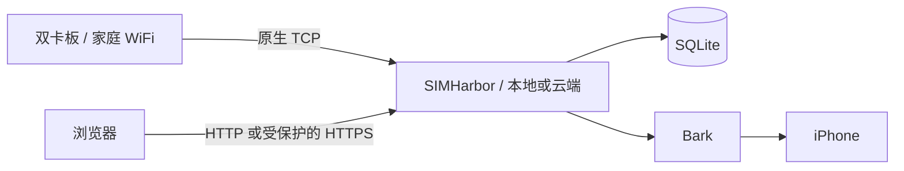

# SIMHarbor

**两张卡，一个管理台。**

SIMHarbor 是为 **绿邮 X 系列双卡 4G 智能板** 打造的自托管管理服务，短信、来电与通知等基础链路已在 **v153 固件**上完成真机验收。把板子留在家中，通过网页集中管理短信、来电和卡状态，再用 Bark 将重要动态送到 iPhone。

留言能力默认关闭。已发布 v1.1.0 至 v1.1.1-rc.3 仅支持局域网上传；v1.1.1-rc.4 增加 HTTPS 公网入口，需单独配置 Tunnel 或反向代理。具体固件的 TLS 兼容性与上传稳定性需在部署环境核对，见[留言说明](docs/voicemail.md)。

**本地部署，数据留在自己身边；云端部署，随时访问管理台。** 两种方式使用同一套应用与数据格式，可按自己的设备和网络选择。

## 为什么选择 SIMHarbor

- **双卡一目了然**：连接、信号、注册网络和卡状态集中展示，短信与来电按卡整理。
- **换槽也能接续历史**：固定卡身份关联记录，卡片名称和通知偏好便于长期管理。
- **重要消息随身看**：Bark 按卡分组，支持短信、未接来电、持续异常与恢复提醒，点击通知直达详情。
- **数据由自己掌握**：SQLite 本地存储，提供收件短信 JSON/CSV 导出、完整业务库备份和本地/云端迁移。
- **发送前心中有数**：短信预览、段数估算、目标确认和发送限额，让每次外发都有清楚的操作记录。
- **部署轻巧**：Go 后端、Vue 前端与 SQLite 组成一个应用，Docker 和源码运行均有完整指南。

## 功能一览

| 功能 | 你可以做什么 |
| --- | --- |
| 短信管理 | 双卡收件、搜索、按卡筛选、长短信组装、已读管理、逐条删除、JSON/CSV 导出 |
| 来电记录 | 查看来电号码或匿名标识、时间与响铃信息，按号码回看历史，接收未接提醒；可另行开启留言。上传方式及版本要求见留言说明 |
| 卡片管理 | 展示板子上的卡片备注与当前位置，按固定卡身份保留历史和通知偏好 |
| iPhone 通知 | 测试 Bark 连接、查看通知进度、失败重试，按卡分组并跳转到短信或来电详情 |
| 状态监控 | 查询板子当前状态，查看最近上报、双卡状态和连接情况，接收持续异常与恢复提醒 |
| 数据维护 | 在线一致备份、完整性检查、迁移恢复，并在核对后通过受控流程恢复外发 |
| 板子管理 | 查询状态和本地短信/通话历史，读取、预览修改并读回核对心跳间隔 |
| 短信外发 | 按需启用，逐条预览和确认，结合身份核验、间隔与日限额管理发送 |

了解更多：[功能说明](docs/features.md)。

## 选择你的部署方式

| | 本地部署 | 云端部署 |
| --- | --- | --- |
| 应用位置 | 家中电脑、NAS 或局域网 Linux 主机 | 自己的 Linux 云服务器 |
| 板子连接 | 家庭 WiFi → 局域网主机 TCP | 家庭 WiFi → 服务器独立 TCP 入口 |
| 网页访问 | 本机、局域网或自建受保护的远程入口 | HTTPS 域名，可配 Cloudflare Tunnel + Access |
| 数据位置 | 自己的本地磁盘或 Docker 卷 | 自己的服务器磁盘或 Docker 卷 |
| 开始使用 | [本地部署指南](docs/deployment-local.md) | [云端部署指南](docs/deployment-cloud.md) |

本地方式即可完成日常管理；希望外出时访问详情，可以为本地实例配置远程入口，或选择云端部署。Bark 通知通过你配置的服务发送，手机使用可达的管理地址打开详情。

## 快速开始

1. 阅读[使用指南](使用指南.md)，选择本地或云端部署。
2. 按[Docker 安装](docs/deployment-docker.md)准备应用，或选择源码运行。
3. 参照[板子配置](docs/hardware-setup.md)设置 WiFi、TCP、加密和事件上报。
4. 登录管理台，核对双卡状态，配置 Bark，开始收件和通知体验。

也可以先用[合成数据体验](docs/development.md#合成数据体验)浏览界面。更多配置、维护与开发资料见[文档目录](docs/README.md)。

## 界面预览

以下使用合成数据展示双卡管理、收件、来电与迁移确认流程；通知状态由本机模拟服务生成。

查看收件、来电与迁移确认

## 工作方式

一个应用串起设备接入、数据存储、管理网页和通知任务，适合个人双卡日常使用。部署时可分别配置网页与设备入口，使用自己的访问凭据和密钥；具体配置见[安全说明](SECURITY.md)。板子参数与扩展型号的接入资料可查阅[厂家在线文档](docs/reference/board/README.md)。

## 版本与开发

最近正式版为 **1.1.1**，增加云端 HTTPS 录音接收、录音缺失与迟到提醒、短信与通话推送记录、录音管理及后台数据库备份，见[更新记录](CHANGELOG.md#111)。从 v1.1.0 或候选版升级见[升级说明](docs/releases.md#从-v110-或候选版升级到-v111)；从 v1.0.4 或更早版本升级，还需核对[数据库兼容性](docs/releases.md#已有实例升级)。

本版可直接读取旧配置，从 v1.1.0 至 rc.4 首次升级会自动迁移至 **schema 20**；rc.5 升级不增加迁移。旧版无法直接打开升级后的库，回退需使用升级前数据库。该正式版 ZIP 不包含 AMR 录音。版本镜像需在对应标签的构建成功后核对使用，发布、更新与回退见[版本维护](docs/releases.md)。

当前源码候选版 **1.1.2-rc.1** 增加可选的录音 ZIP 备份与恢复、跨浏览器播放状态和未读角标，以及统一的系统推送查询。首次启动会迁移至 **schema 21**（共享播放状态与系统推送历史），旧配置可沿用；v1.1.1 不能直接打开新库。含录音备份使用格式 2，需用包含该功能的新版维护工具恢复；未勾选录音仍为格式 1，见[数据维护](docs/data-maintenance.md)及[候选版变更](CHANGELOG.md#112-rc1)。

候选镜像需在 `v1.1.2-rc.1` 标签的构建成功后使用；升级见[候选版说明](docs/releases.md#从-v111-升级到-v112-rc1)。

开发和检查命令见 [CONTRIBUTING.md](CONTRIBUTING.md)。依赖版本见 [go.mod](go.mod)、[前端锁文件](web/package-lock.json)和 [Dockerfile](Dockerfile)。当前暂未添加许可证；复用与分发请先联系维护者，第三方依赖适用各自许可。
