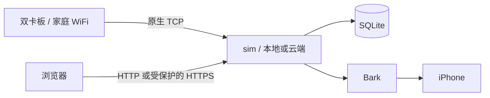

# sim

双卡 SIM 智能板的自托管管理服务。通过网页查看短信、来电和卡状态，通过 Bark 接收 iPhone 通知。

**支持本地部署和云端部署，使用同一套应用与数据格式。** 适用于个人、单板、双卡场景。

## 功能

| 功能 | 支持内容 |
| --- | --- |
| 短信管理 | 双卡收件、搜索、按卡筛选、长短信组装、已读、逐条删除、JSON/CSV 导出 |
| 来电记录 | 来电号码或匿名标识、时间、响铃信息、同号码历史、未接来电提醒 |
| 卡片管理 | 固定卡身份、名称和号码展示、历史卡目录、按卡通知开关 |
| iPhone 通知 | Bark 连接测试、失败重试、稳定卡分组、点击打开短信或来电详情 |
| 状态监控 | 连接与状态新鲜度、双卡状态、持续异常与恢复提醒 |
| 数据维护 | SQLite 一致备份、完整性检查、恢复到新目录、恢复后的外发保护 |
| 板子管理 | 状态与本地历史只读查询、心跳间隔读取及确认修改 |
| 受控外发 | 预览、二次确认、身份核验和费用限额；默认关闭，未知结果不自动重发 |

详细行为和限制见[功能说明](docs/features.md)。

## 选择部署方式

| | 本地部署 | 云端部署 |
| --- | --- | --- |
| 应用位置 | 家中电脑、NAS 或局域网 Linux 主机 | 自己的 Linux 云服务器 |
| 板子连接 | 家庭 WiFi → 局域网主机 TCP | 家庭 WiFi → 服务器独立 TCP 入口 |
| 网页访问 | 本机、局域网或自建受保护的远程入口 | HTTPS 域名，可配 Cloudflare Tunnel + Access |
| 数据位置 | 自己的本地磁盘或 Docker 卷 | 自己的服务器磁盘或 Docker 卷 |
| 文档 | [本地部署](docs/deployment-local.md) | [云端部署](docs/deployment-cloud.md) |

不要求使用云服务。Bark 通知需要应用能连接所配置的 Bark 服务；本地部署的详情链接也需要手机能访问管理网页。

## 快速开始

- [使用指南](使用指南.md)：部署选择、安装顺序和首次接入。
- [Docker 安装](docs/deployment-docker.md)：生成私有配置、构建和运行。
- [板子配置](docs/hardware-setup.md)：WiFi、TCP、加密、上报事件、本地存储和来电策略。
- [合成数据体验](docs/development.md#合成数据体验)：无需板子，先体验网页。
- [文档目录](docs/README.md)：配置、维护、排障与开发资料。

## 工作方式

Go 后端、Vue 前端与 SQLite 数据库组成单实例应用。Docker 支持按目标平台构建；也可以从源码运行。依赖版本以 [go.mod](go.mod)、[前端锁文件](web/package-lock.json)和 [Dockerfile](Dockerfile) 为准。

协议面向绿邮 X 系列智能板，其他型号或固件需单独核对兼容性。[厂家资料](docs/reference/board/README.md)仅保留在线入口。项目不提供 VoIP、iPhone 实时双向通话、多用户或多板管理。

## 安全与数据

每个实例使用自己的管理员 Token、设备密钥与 Bark Key。短信、SIM 身份、数据库、日志和私有配置均不属于源码分发内容。

mode1 仅上行加密，下行明文；AES-CBC 本身不提供消息认证或防重放。网页认证不能代替设备 TCP 入口保护，部署前请阅读[安全说明](SECURITY.md)。

## 开发与许可

开发和检查命令见 [CONTRIBUTING.md](CONTRIBUTING.md)。当前暂未添加许可证，尚未授予通用开源复用许可；第三方依赖适用各自许可。
