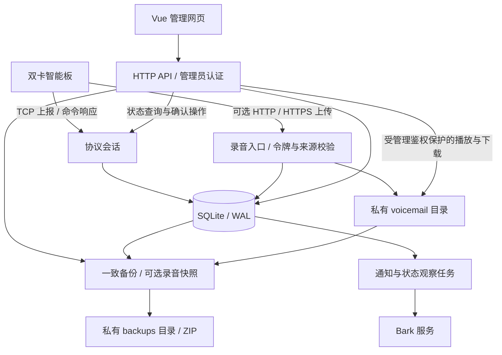

# 架构

SIMHarbor 是单实例 Go 服务，提供设备 TCP、录音 HTTP 接收、管理 HTTP API、Vue 静态网页与后台任务。SQLite 保存业务记录、录音索引和任务状态，AMR 文件保存在私有数据目录；不需要外部数据库或消息队列。

## 运行模型

- 一块板、两个当前卡槽；固定卡身份可保留换槽与历史卡记录。
- 协议解析、持久化、通知和网页在本地/云端共用，通过监听地址、来源与路径配置部署环境。
- 心跳与状态上报更新当前设备信息和卡资料，不向旧事件摘要表追加记录；既有历史保留，短信与来电继续按业务记录去重。
- 收件持久化与通知任务分离，通知失败不丢弃已经入库的短信。
- 通知的外部网络等待不占用来电与录音的入库协调锁。删除和关闭卡片通知仍与正在发送的任务协调，保留实际发送结果；已经发出的请求无法撤回。
- 录音独立上传，按可核对的来电信息关联；无法唯一关联时保留为未关联录音，不按最近一通猜测。播放状态由服务端持久保存，同一实例的浏览器共享。
- 短信、通话和系统提醒统一查询，首页待推送、重试及成功统计覆盖所有持久任务；Bark 接受不等于手机已收到。
- 待推送与重试按各类任务表直接汇总，推送记录只组合所选类型的数据源。网页隐藏时暂停定时读取，返回后刷新；列表按当前页面读取，已提交的操作、备份和下载不因页面隐藏而取消或重发。
- 录音链路复用有限保留的脱敏运行记录，按明确的通话身份关联；缺少身份的音频报告不猜测归属。查询同时核对持久化通话、通知任务和录音文件，不新增诊断数据库表。
- 外发先持久记录认领再写入设备连接，未知结果不自动重发；完整操作历史是防重复的重要前提。
- 统一配置保存在固定数据目录；进程锁避免同目录被应用和停服维护同时占用。

## 部署与数据管理

本地可直接运行或使用 Docker；云端可在网页前增加 HTTPS、Tunnel 与 Access。HTTP 管理入口与设备 TCP 分别设置访问策略。录音默认关闭；局域网 HTTP 使用设备来源白名单，公网 HTTPS 在受控代理终止 TLS，并由应用校验实际代理 IP 和路径令牌，不信任转发来源头。

ZIP 备份默认只包含数据库与 manifest；勾选录音时以格式 2 同时保存 AMR 和逐文件摘要。运行配置、凭据、容量提醒私有进度和日志另行保存。恢复先校验 ZIP，再写入新目录，暂停旧待发送任务并启用外发保护；迁移确认后才能恢复外发管理。实例间使用一致备份迁移，不自动同步数据库或录音。

## 目录

| 路径 | 内容 |
| --- | --- |
| `cmd/sim` | 应用入口 |
| `cmd/simulate` | 本机合成设备模拟器 |
| `cmd/check` | 容器健康检查 |
| `cmd/maintain` | 备份、检查、恢复工具 |
| `internal/protocol` | 帧及字段解析 |
| `internal/server` | 会话、API、通知与控制 |
| `internal/store` | 数据模型、事务与迁移 |
| `internal/maintenance` | 一致快照、录音打包、完整性检查与受控恢复 |
| `internal/config`、`internal/diagnostics` | 配置与脱敏诊断 |
| `web` | Vue 网页、请求流程和测试 |
| `configs`、`deploy` | 合成配置、部署模板 |

协议实现见[协议说明](protocol-notes.md)，配置优先级见[配置说明](configuration.md)，检查方法见[开发指南](../CONTRIBUTING.md)。
