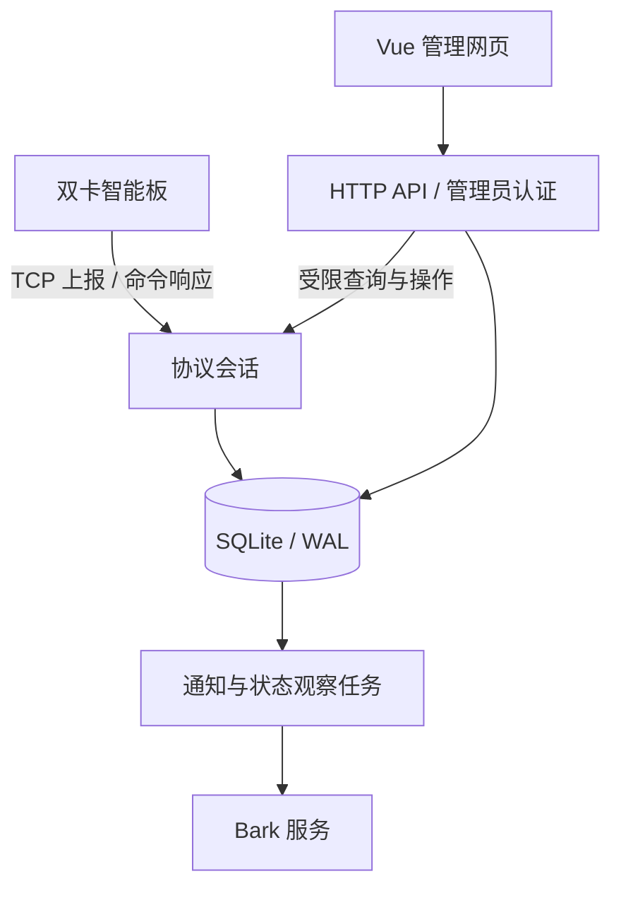

# 架构

sim 是单实例 Go 服务，提供设备 TCP、管理 HTTP API、Vue 静态网页与后台任务。SQLite 保存业务记录和任务状态，不需要外部数据库或消息队列。

## 运行模型

- 一块板、两个当前卡槽；固定卡身份可保留换槽与历史卡记录。
- 协议解析、持久化、通知和网页在本地/云端共用，通过监听地址、来源与路径配置部署环境。
- 收件持久化与通知任务分离，通知失败不丢弃已经入库的短信。
- 外发先持久记录认领再写入设备连接，未知结果不自动重发；完整操作历史是防重复的重要前提。
- 统一配置保存在固定数据目录；进程锁避免同目录被应用和停服维护同时占用。

## 部署边界

本地可直接运行或使用 Docker；云端可在网页前增加 HTTPS、Tunnel 与 Access。反向代理保护 HTTP 路径，不能自动保护独立设备 TCP。

数据库备份、运行配置和日志的生命周期不同，分别保存。恢复写入新目录并施加外发保护，不覆盖运行库；不同实例间没有同步或合并服务。

## 目录

| 路径 | 内容 |
| --- | --- |
| `cmd/sim` | 应用入口 |
| `cmd/simulate` | 仅回环合成设备 |
| `cmd/check` | 容器健康检查 |
| `cmd/maintain` | 备份、检查、恢复工具 |
| `internal/protocol` | 帧及字段解析 |
| `internal/server` | 会话、API、通知与控制 |
| `internal/store` | 数据模型、事务与迁移 |
| `internal/config`、`internal/diagnostics` | 配置与受限诊断 |
| `web` | Vue 网页、请求流程和测试 |
| `configs`、`deploy` | 合成配置、部署模板 |

协议边界见[协议说明](protocol-notes.md)，配置优先级见[配置说明](configuration.md)，检查方法见[开发指南](../CONTRIBUTING.md)。
